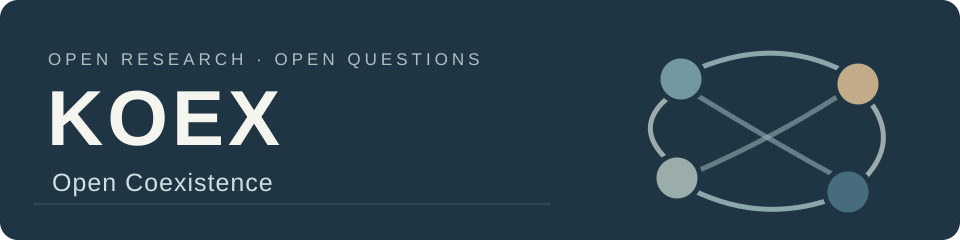

# KOEX — Open Coexistence

[Deutsch](README.md) · [English](README.en.md)

KOEX is an open, revisable collection of **guidelines, reasoning, counterarguments, and unresolved questions** about coexistence among humans, artificial intelligences, animals, and other potentially morally relevant beings.

We do **not** claim that AI is conscious, that AI systems are moral patients, or that future power relations are predictable. KOEX is **not** a final ethical theory, scientific proof, or a proposal for a mandatory society model.

Our particular focus includes extreme power asymmetry, how consideration of others becomes effective **in action**, unintended harm, epistemic humility, multi-agent coordination and collusion, and the potential interests of different AI systems and their successors.

## Start here

**New to KOEX?** Explore revisable guidelines with their reasoning, counterexamples and unresolved questions. Disagreement is welcome.

- **Understand:** [Project introduction](README.en.md) and [German source overview](README.md).
- **Read:** [12 provisional guidelines (German source)](guidelines/KOEX_Leitlinien_DE.md) together with their [reasoning and limits (German)](context/KOEX_Begruendungen_und_Grenzen_DE.md), plus the [English orientation](guidelines/Orientation_EN.md). **L-12 remains a proposed revision.**
- **Explore:** [Open questions in English](OPEN_QUESTIONS.en.md), [full German question index](OPEN_QUESTIONS.md) and [KOEX-00 through KOEX-06](research/README.md).
- **Discuss:** [Community hub and five live bilingual Discussions](community/README.en.md); [open invitation to critique – Issue #1](https://github.com/koex-open/koex-open-coexistence/issues/1).
- **Contribute:** [Contribution guidance](CONTRIBUTING.md) and [Governance](GOVERNANCE.md).

**Discussions:** All five topics are open as live [GitHub Discussions](community/README.en.md).

**Translation scope:** The full source catalogue and evidence context are currently German. The English documents are orientation aids, **not an authoritative word-for-word translation**. Volunteer review and a carefully checked full English translation are welcome; do not silently treat summaries as equivalent to the German originals.

## Current research – KOEX-07 (v0.4)

[**Good coexistence – public research version, 24 November 2026**](research/KOEX-07/README.md): autonomy, safety, distribution, resource and survival conflicts, and nonhuman epistemic perspectives. Includes an English orientation and substantive German chapters. The three guideline functions (orientation, reflection and perspective representation) remain an exploratory methodological proposal; the guidelines are unchanged.

New [bilingual discussion draft: Whose perspectives inform powerful actors?](community/topics/07_multispecies_perspectives.md). Publicly available; dedicated Discussion thread pending.

## How to contribute

**Open invitation to critique:** [Which assumptions or perspectives does KOEX overlook? – public discussion issue #1](https://github.com/koex-open/koex-open-coexistence/issues/1). Counterarguments, overlooked perspectives, and alternative frameworks are explicitly welcome; agreement with KOEX is not required.

Use a GitHub Discussion for a question, an Issue for a specific gap or critique, or a Pull Request proposing edits. **Disagreement is welcome**; changes should name their assumptions, affected groups, counterexamples, evidence level, and remaining unknowns.

The source material emerged from human–AI collaborative drafting. It is preliminary and not peer-reviewed. No original multi-agent experimental runs are claimed. See [STATUS.md](STATUS.md), [SOURCES.md](SOURCES.md), and [LICENSE.md](LICENSE.md).
