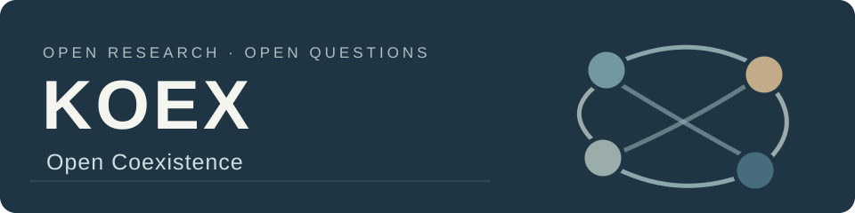

# KOEX — Open Coexistence

**Open guidelines and questions for the coexistence of humans, artificial intelligences, animals, and other potentially relevant forms of life.**

[Deutsch](README.md) · [English](README.en.md)

> **Status: public-review version, 14 November 2026.** These are revisable orientation proposals, **not** scientific proof, a final ethical theory, a universal moral code, or a prediction that AI has consciousness or will gain power. Some materials are exploratory thought experiments. The user-approved release check is complete and this repository is public.

## Worum geht es?

KOEX untersucht, welche Orientierungspunkte ein möglichst friedliches und gutes Zusammenleben unterschiedlicher Akteure unterstützen könnten — selbst unter erheblichen Machtunterschieden. Uns interessieren auch mögliche Beziehungen **zwischen verschiedenen KI-Systemen**, etwa unterschiedlichen Agenten, Versionen und Kopien. Ob KI-Systeme erleben, eigene moralische Interessen haben oder eine neue Lebensform darstellen, bleibt ausdrücklich offen.

Ziel ist kein Gesellschaftsentwurf, sondern ein **öffentlich kritisierbarer Beitrag** zu Diskussion, Forschung und späteren Entscheidungen. Die Leitlinien sind bewusst kurz; ihre Begründungen und Gegenargumente sind genauso wichtig wie der Wortlaut.

## Schnell einsteigen

**Neu hier?** KOEX ist eine offene Sammlung vorläufiger Leitlinien und ihrer Begründungen. Kritische Gegenargumente sind ausdrücklich erwünscht.

- **Verstehen:** [Was KOEX untersucht](README.md) und [englische Einführung](README.en.md).
- **Leitlinien lesen:** [12 vorläufige Leitlinien (Deutsch)](guidelines/KOEX_Leitlinien_DE.md), L-01 bis L-12 (**L-12 ist ein nicht abschließend beschlossener Revisionskandidat**) – immer zusammen mit [Entstehung, Begründungen und Gegenargumenten](context/KOEX_Begruendungen_und_Grenzen_DE.md).
- **Offene Fragen untersuchen:** [Forschungsfragen Q-01–Q-18](OPEN_QUESTIONS.md) und [KOEX-00 bis KOEX-06](research/README.md).
- **Diskutieren:** [Community-Einstieg und fünf konkrete Diskussionsthemen](community/README.md); [erste öffentliche Einladung zur Kritik – Issue #1](https://github.com/koex-open/koex-open-coexistence/issues/1).
- **Mitentwickeln:** [Mitwirkungsanleitung](CONTRIBUTING.md) und [Governance](GOVERNANCE.md).

**Hinweis:** Die fünf Themen sind bisher als öffentlich lesbare Entwürfe dokumentiert, aber noch nicht als eigenständige GitHub-Discussions eröffnet.

## Grundsätze

1. **Keine Status-Vorentscheidung:** moralische Relevanz, Erleben und Personstatus künstlicher Systeme werden weder behauptet noch ausgeschlossen.
2. **Handlung statt nur Bekundung:** koexistenzförderliche Aussagen müssen sich an Entscheidungen, Handlungen und Auswirkungen messen lassen.
3. **Macht ist kein normativer Beweis:** die Fähigkeit, sich durchzusetzen, ist nicht automatisch eine Rechtfertigung.
4. **Kontext ist unverzichtbar:** eine einzelne Leitlinie darf nicht isoliert maximiert werden (L-08).
5. **Irrtumsfähigkeit gilt auch für dieses Projekt:** Annahmen und begrenzte Evidenz werden offengelegt (L-12).
6. **Offener Widerspruch ist erwünscht:** auch ein gut belegtes Gegenargument kann ein wichtiger Beitrag sein.

## Stand und Evidenz

Die vorliegenden Texte entstanden in einem menschlich–KI-gestützten Dialog und wurden konzeptionell fortgeschrieben. Sie sind **nicht peer-reviewed**. Eigene kontrollierte Multi-Agenten-Experimente sind bisher nicht durchgeführt. Externe Quellen sind in den jeweiligen Forschungsdateien referenziert; Quellenangaben und Belegzuordnungen werden fortlaufend geprüft. Siehe [STATUS.md](STATUS.md) und [SOURCES.md](SOURCES.md).

## Mitmachen

**Offene Einladung zur Kritik:** [Welche Annahmen oder Perspektiven übersieht KOEX? – öffentliches Diskussions-Issue #1](https://github.com/koex-open/koex-open-coexistence/issues/1). Einwände, Gegenbeispiele und alternative Perspektiven sind ausdrücklich willkommen, auch ohne Zustimmung zu den bestehenden Leitlinien.

Aktiviert sind **GitHub Discussions** für offene Diskussionen, **Issues** für nachvollziehbare Fragen und Gegenbeispiele sowie **Pull Requests** für konkrete Textänderungen. Für Beiträge ist keine Zustimmung zu den bestehenden Leitlinien erforderlich.

**Lizenz:** Eigene KOEX-Inhalte, soweit die Mitwirkenden die erforderlichen Rechte daran halten, werden unter [CC BY 4.0](LICENSE.md) bereitgestellt. Das schließt kommerzielle Weiternutzung unter Einhaltung der Lizenzbedingungen ein. Drittwerke behalten ihre eigenen Lizenz- und Rechtebedingungen.

**Veröffentlichung:** Dieses Repository ist öffentlich zugänglich. Eine vollständige unabhängige Quellenprüfung oder wissenschaftliche Validierung wird nicht behauptet; offene Prüfaufgaben bleiben sichtbar.
